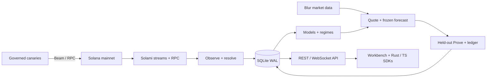

# Alight

**Measure landing odds. Freeze the claim. Let the next transactions test it.**

[](https://github.com/hicksonhaziel/Alight/actions/workflows/ci.yml)

[**Watch the demo · 2 min 55 sec**](https://youtu.be/-jXC9uEXAwE)

**Alight turns Solana transaction-landing claims into testable evidence.**
Bots, wallets and trading backends must choose a route, priority fee and tip
before knowing whether a transaction will arrive in time. An RPC acknowledgment
cannot answer that question, and a successful landing can still miss the deadline.

Alight is a self-hosted observatory that sends small, budgeted test transactions
called **canaries** through Solami Beam and RPC, observes their outcomes with
**Solami's live data**, and estimates the chance of landing within a chosen
number of slots. Quotes show uncertainty, sample count and freshness; sparse or
stale evidence produces an explicit refusal.

The loop is **measure → forecast → freeze → test → verify**. Freeze a claim
before Prove tests it on new canaries whose outcomes never train the model.
A hash-chained ledger retains the claim for inspection afterward. Use the
Workbench, CLI, or repository-local Rust and TypeScript clients to follow the loop.

[Documentation](docs/README.md) · [Architecture](docs/architecture.md) ·
[Solami integrations](#built-with-solami) ·
[Public datasets](https://hicksonhaziel.github.io/Alight/) ·
[Limitations](docs/limitations.md)

## Run locally

From the repository root:

```sh
./scripts/quickstart.sh
```

One command builds Alight and starts a populated **SIMULATED** Workbench at
[localhost:5173](http://localhost:5173), with no provider key or SOL required.
Press `Ctrl+C` to stop both local servers. See the [quick start](docs/quickstart.md)
for prerequisites, operator access and your own Solami key.


## From a send to a testable claim

- **Observe:** measure the slot clock, compare gRPC/Mirage/RPC/Webhook evidence,
  and inspect market tips and Blur data.
- **Quote:** show landing probability, a 95% interval, effective sample count,
  evidence age, and optional conditional delay costs. Refuse unsupported advice.
- **Prove:** freeze a claim before sending held-out canaries; show on-time and
  late outcomes and an honest verdict.
- **Verify:** inspect the hash-chained forecast ledger, wallet receipts,
  downloadable datasets, and mainnet memo commitments.

| Mode | Evidence | Sends / cost |
| --- | --- | --- |
| `sim` | Seeded synthetic outcomes | No network, no SOL |
| `replay` | Captured events or model runs | No sends, no SOL |
| `observe` | Mainnet streams and read APIs | Provider usage; no sends |
| `live` | Mainnet observations and owned canaries | Governed sends; spends SOL |

Live mode uses a dedicated payer, balance reserve, and durable daily/burst caps.
A landed, untipped zero-priority RPC canary in the measured run paid **5,000
lamports**; Beam canaries also paid the selected tip. Defaults and experiment
mix can cost substantially more. [Understand the controls before enabling Live](docs/operations.md).

## How it fits together



Rust/Tokio runs the collector, models, and API; React/Vite serves the Workbench.
[Explore the architecture](docs/architecture.md) for crate boundaries and the
forecast-to-Prove sequence.

## Built with Solami

Seven Solami products connect the measurement loop, from sending a canary to
explaining its outcome and cost.

| Product | Why Alight uses it | How it is used |
| --- | --- | --- |
| **gRPC** | Measure the network clock and capture landing evidence. | Yellowstone slot, block-metadata and transaction streams feed the collector, canary resolver and transfer/tip tape. |
| **Mirage** | Compare observation paths and expose gaps or lag. | A saved WebSocket subscription delivers binary Yellowstone updates; Alight matches canary signatures and tracks each observer's receipt time. |
| **RPC** | Provide an untipped send baseline and check chain state. | JSON-RPC submits baseline canaries, checks signatures and block heights, and retrieves finalized transactions for outcome and fee verification. |
| **Beam — QUIC + HTTP** | Test tipped submission settings under the same budget controls. | QUIC uses the Solami SDK. HTTP sends a transaction with a Beam-recipient tip through the configured Solami RPC endpoint; plain RPC omits that tip. |
| **Blur** | Estimate the market cost of waiting when evidence supports it. | REST trades/candles and WebSocket swap updates feed pool-specific, conditional delay-cost estimates. Sparse or stale market evidence leaves costs unavailable. |
| **Data API** | Build bounded wallet receipts with fee and tip context. | A wallet trade index and venue-tip summary supply context; finalized RPC reads verify each distinct transaction's execution fees and known payments. Missing coverage stays visible. |
| **Webhooks** | Capture pushed outcomes for owned transactions. | Alight verifies HMAC-SHA256 over the exact request body, then persists normalized signature, slot and result as observer evidence. |

gRPC and Mirage are separate transports from the same provider; their agreement
does not establish independent infrastructure or trust. See the
[integration boundaries](docs/architecture.md) and [receipt scope](docs/receipts.md).

## Evidence you can inspect

On **12 October 2026**, a frozen Live RPC forecast was tested against **40
held-out Memo canaries**: **30/40** met its four-slot target. The observed rate
was **75%**, with a Wilson 95% interval of **59.8–85.8%**; the verdict was
**CONSISTENT** with the frozen 60.8% prediction.
[The full receipt](data/live-prove-validation.json) retains the configuration,
forecast hash, timing, finalized audit, and limitations.


Also inspect the [owned Webhook delivery](data/webhook-owned-validation.json),
[human offline setup check](data/human-quickstart-validation.json), and
[mainnet-anchored Sim ledger](data/anchors/sim-ledger-mainnet.json).
The anchor and public sample dataset are **Sim**, not Live performance.
The [final review receipt](data/final-review-validation.json) records a later
30-minute Live check, finalized fee reconciliation, and remaining coverage gaps.
The [Live quote receipt](data/live-quote-validation.json) captures a subsequent
supported RPC quote with its timestamp, evidence age, sample count and fee audit.

These results validate a working measurement loop for the tested configuration.
They do not establish swap performance, broad calibration, route rankings, or
complete four-observer agreement. Live evidence decays; Observe alone does not
keep a quote supported. The 48-hour check is still pending; its current window
retains failures and requires review.

## Go deeper

| Need | Read |
| --- | --- |
| First run and your own Solami key | [Quick start](docs/quickstart.md) |
| Commands, budgets, troubleshooting | [Operations](docs/operations.md) |
| Rust / TypeScript clients and local integration | [SDK guide](docs/sdk.md) |
| API payloads, authentication, units | [Contracts](docs/contracts.md) |
| Estimators, outcomes, registered analysis | [Methodology](docs/methodology.md) |
| Frozen tests and regime changes | [Prove](docs/prove-methodology.md) · [Regimes](docs/regime-methodology.md) |
| Exports, receipts, commitments | [Datasets](docs/dataset.md) · [Receipts](docs/receipts.md) · [Anchoring](docs/anchoring.md) |
| Scope, caveats, historical decisions | [Limitations](docs/limitations.md) · [Decisions](docs/decisions.md) |

CI checks Rust formatting, Clippy/tests, SDK and web checks, browser flows,
dataset integrity, and publishable files. See [verification commands](docs/operations.md).
Software uses the [MIT license](LICENSE). Exported datasets use **CC BY 4.0**.
