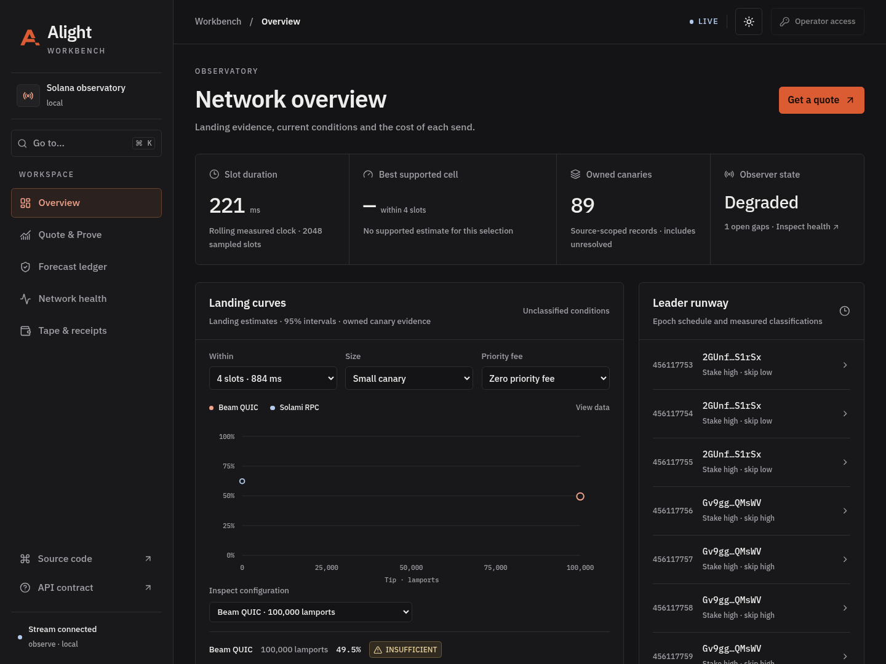
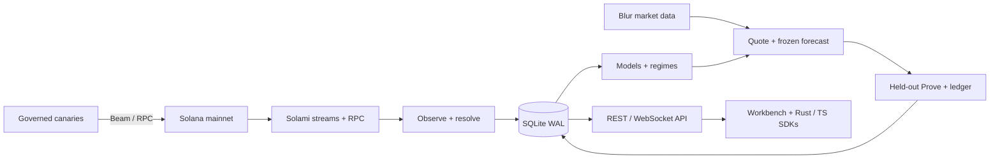
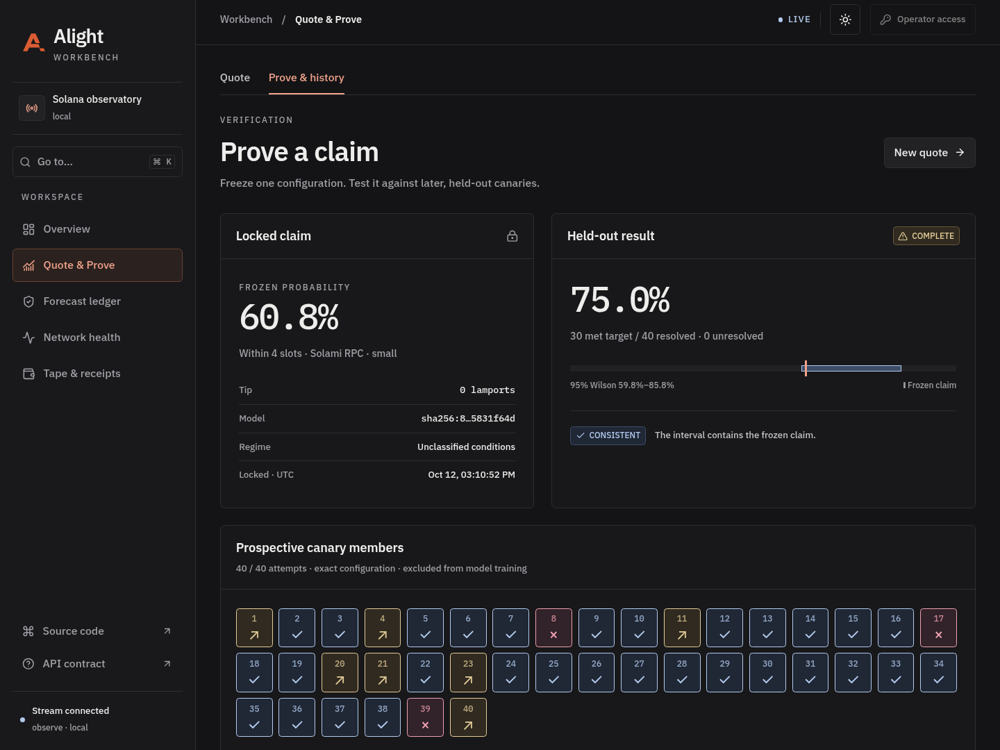

# Alight

**Measure Solana transaction landing. Freeze a forecast. Check the proof.**

[](https://github.com/hicksonhaziel/Alight/actions/workflows/ci.yml)

Alight turns Solami streams and budgeted mainnet canaries into landing quotes
with uncertainty, held-out tests, and a verifiable forecast ledger. Every view
distinguishes Live, Sim, and Replay evidence.

[Documentation](docs/README.md) · [Architecture](docs/architecture.md) ·
[Public datasets](https://hicksonhaziel.github.io/Alight/) ·
[Limitations](docs/limitations.md)



## What it does

- **Observe:** measure the slot clock, compare gRPC/Mirage/RPC/Webhook evidence,
  and inspect market tips and Blur data.
- **Quote:** show landing probability, a 95% interval, effective sample count,
  evidence age, and optional conditional delay costs. Refuse unsupported advice.
- **Prove:** freeze a claim before sending held-out canaries; show on-time and
  late outcomes and an honest verdict.
- **Verify:** inspect the hash-chained forecast ledger, wallet receipts,
  downloadable datasets, and mainnet memo commitments.

## Run locally, without keys

Requires the pinned **Rust 1.96.1**, **Node 22.22+**, and **Python 3**.
Run these commands from the repository root:

```sh
cargo build --locked -p alight -p alightd
npm --prefix web ci --ignore-scripts --no-audit --no-fund
mkdir -p .alight/local

# Terminal 1: synthetic evidence and the API; no network or transaction sends.
target/debug/alight run --mode sim --seed 42 --sim-canaries 900 \
  --sim-regimes true --db .alight/local/workbench.db --bind 127.0.0.1:8080

# Terminal 2: the Workbench.
npm --prefix web run dev
```

Open [localhost:5173](http://localhost:5173). The badge reads **SIMULATED**.
To lock forecasts and run synthetic Prove tests, configure a local API operator
key as described in [operations](docs/operations.md). It is separate from a
wallet key. [CLI and offline verification examples](docs/operations.md) cover
deterministic model runs, Replay, and ledger checks.

## Connect your own Solami key

Copy [`.env.example`](.env.example) to `.env` if you do not already have one.
Set your dashboard RPC/gRPC endpoints and read credentials. Start in Observe:

```sh
target/debug/alight doctor --mode observe
target/debug/alight run --mode observe --db .alight/local/observe.db
```

Observe needs no funded wallet and sends no transactions. Mirage, Blur,
Webhooks, and Data API permissions are configured separately; missing coverage
stays visible. See [setup, environment variables, and live controls](docs/operations.md).

| Mode | Evidence | Sends / cost |
| --- | --- | --- |
| `sim` | Seeded synthetic outcomes | No network, no SOL |
| `replay` | Captured events or model runs | No sends, no SOL |
| `observe` | Mainnet streams and read APIs | Provider usage; no sends |
| `live` | Mainnet observations and owned canaries | Governed sends; spends SOL |

Live mode uses a dedicated payer, balance reserve, and durable daily/burst caps.
A landed, untipped zero-priority RPC canary in the measured run paid **5,000
lamports**; Beam canaries also paid the selected tip. Defaults and experiment
mix can cost substantially more. [Understand the controls before enabling Live](docs/operations.md).

## How it fits together



Rust/Tokio runs the collector, models, and API; React/Vite serves the Workbench.
Solami supplies gRPC, Mirage, RPC, Blur, Webhooks, Data API, and Beam's QUIC/HTTP
submission routes. [Architecture and integration boundaries](docs/architecture.md)
explain what each product does and what its evidence can establish.

## Evidence you can inspect

On **12 October 2026**, a frozen Live RPC forecast was tested against **40
held-out Memo canaries**: **30/40** met its four-slot target. The observed rate
was **75%**, with a Wilson 95% interval of **59.8–85.8%**; the verdict was
**CONSISTENT** with the frozen 60.8% prediction.
[The full receipt](data/live-prove-validation.json) retains the configuration,
forecast hash, timing, finalized audit, and limitations.



Also inspect the [owned Webhook delivery](data/webhook-owned-validation.json),
[human offline setup check](data/human-quickstart-validation.json), and
[mainnet-anchored Sim ledger](data/anchors/sim-ledger-mainnet.json).
The anchor and public sample dataset are **Sim**, not Live performance.

These results validate a working measurement loop for the tested configuration.
They do not establish swap performance, broad calibration, route rankings, or
complete four-observer agreement. Live evidence decays; Observe alone does not
keep a quote supported. The 48-hour check is still pending; its current window
retains failures and requires review.

## Go deeper

| Need | Read |
| --- | --- |
| Setup, commands, budgets, troubleshooting | [Operations](docs/operations.md) |
| API payloads, units, SDKs | [Contracts](docs/contracts.md) |
| Estimators, outcomes, registered analysis | [Methodology](docs/methodology.md) |
| Frozen tests and regime changes | [Prove](docs/prove-methodology.md) · [Regimes](docs/regime-methodology.md) |
| Exports, receipts, commitments | [Datasets](docs/dataset.md) · [Receipts](docs/receipts.md) · [Anchoring](docs/anchoring.md) |
| Scope, caveats, historical decisions | [Limitations](docs/limitations.md) · [Decisions](docs/decisions.md) |

CI checks Rust formatting, Clippy/tests, SDK and web checks, browser flows,
dataset integrity, and publishable files. See [verification commands](docs/operations.md).
Exported datasets use **CC BY 4.0**; no repository-wide software license has
been declared.
