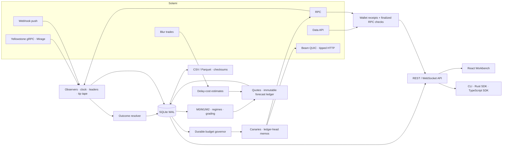
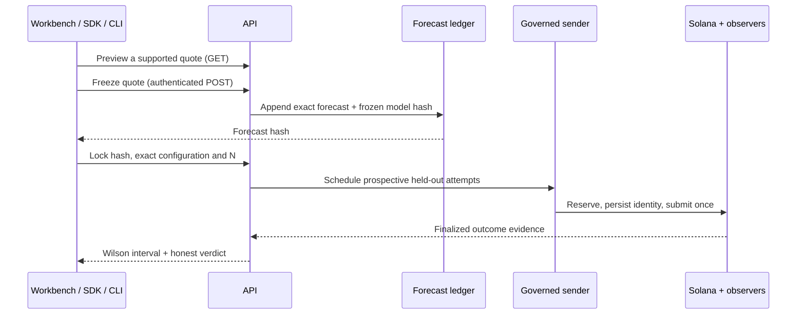

# Architecture

Alight is a Rust daemon with a SQLite WAL store, an axum REST/WebSocket API,
a React Workbench, and Rust/TypeScript developer clients. The daemon owns
collection, resolution, modeling and background diagnostics. The UI displays
the same source-scoped evidence exposed to clients.

Beam HTTP submits a tipped transaction to the configured Solami RPC endpoint;
plain RPC submits without the Beam tip. They are distinct experimental
treatments sharing an HTTP endpoint. Beam QUIC uses the pinned Solami SDK.
gRPC and Mirage are separate transports from the same provider; agreement
does not establish independent infrastructure or trust.

## Forecast and Prove flow

Held-out attempts never train the model. Unknown submissions stay charged and
are resolved after restart; they are not automatically rebroadcast. A timeout
cannot establish expiry. An insufficient quote authorizes no recommendation.

## Code map

| Path | Responsibility |
| --- | --- |
| `bin/alightd/`, `bin/alight/` | Supervised daemon and CLI |
| `crates/alight-types/` | Shared wire contracts, units, validation and canonical JSON |
| `crates/alight-store/` | Migrations, atomic persistence, evidence and ledger storage |
| `crates/alight-ingest/`, `crates/alight-tape/` | Provider normalization, clocks, leaders and passive transfers |
| `crates/alight-canary/` | Sole signing/sending path, governor, transaction builder and resolver |
| `crates/alight-model/`, `crates/alight-forecast/`, `crates/alight-prove/` | Estimation, immutable forecasts, grading and held-out validation |
| `crates/alight-diagnostics/`, `crates/alight-notify/` | Regime/observer diagnostics and configured alert delivery |
| `crates/alight-econ/`, `crates/alight-tape/src/receipts.rs` | Conditional market cost and wallet accounting |
| `crates/alight-sim/` | Seeded offline environment and reproducible replay |
| `crates/alight-api/`, `crates/alight-client/`, `sdk/ts/` | API and developer clients |
| `web/`, `deploy/`, `scripts/` | Workbench, service templates and bounded verification tools |

## Operating boundaries

| Mode | Source | Network | Signing/sending |
| --- | --- | --- | --- |
| Observe | Live | Reads provider streams/history | Disabled |
| Live | Live | Reads and submits governed attempts | Enabled only with configured identities and passing gates |
| Sim | Sim | None | None; synthetic outcomes |
| Replay | Replay, or preserved Sim for model replay | None | None; retained evidence only |

Provider credentials remain server-side. Public reads are bounded and
rate-limited; quote freeze and Prove require an operator bearer key. Wallet
history reads are additionally bounded and cached. Signing, database limits,
observer freshness, wallet reserve and budget checks precede broadcast.
See [operations](operations.md), [contracts](contracts.md) and
[limitations](limitations.md) for the exact controls and evidence scope.
